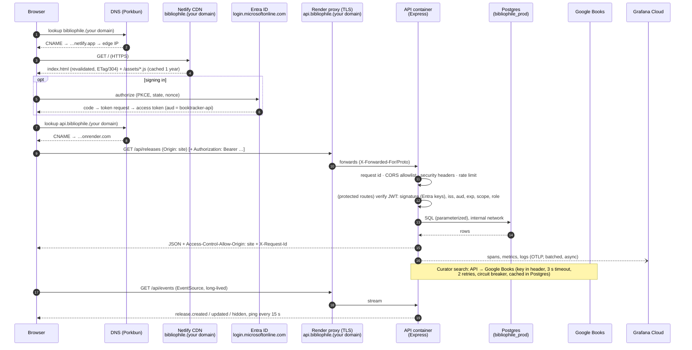
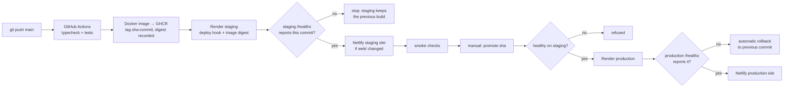
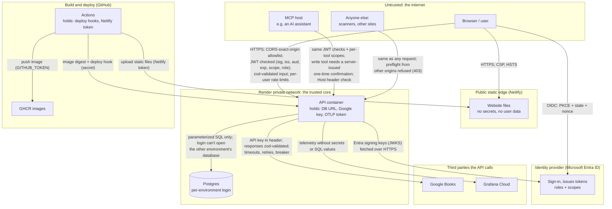

# Architecture (Q2): request path and trust boundaries

## 1. Request path

What happens when someone opens the site and it loads the releases list.

Deploys take a separate path (no user traffic):

## 2. Trust boundaries

Each dashed box is a zone that trusts what's inside it more than what crosses
into it. Every arrow that crosses a box is a boundary, and the label says
what is checked there.

### What each boundary assumes

| Boundary | We trust | We don't trust, so we check |
| --- | --- | --- |
| Internet → website | Netlify serves our files intact over TLS | Nothing to check: the site is public and holds no secrets. CSP limits what a page can load or call |
| Internet → API | Only Entra's signature on a token | Everything else: Origin (CORS), token claims, every input (zod), request rate, Host header for /mcp |
| Browser ↔ Entra | Entra authenticates the user | The redirect back: `state` (CSRF) and `nonce` (replay), PKCE so a stolen code is useless |
| API → Postgres | The database itself | Nothing from users reaches SQL as text: parameters only. Each environment's login is confined to its own database |
| API → Google Books | That it's Google (TLS) | The response shape (zod), its speed (timeout), its availability (breaker, stale cache) |
| API → Grafana | Grafana stores what we send | What we send: no tokens, no API key (header, not URL), no SQL parameter values |
| GitHub → Render/Netlify | Actions runs our workflow | Production only takes a commit that staging reports healthy, and only stays on it if `/healthz` agrees |

Secrets never cross into the browser or the repository: they live in Render
(runtime), GitHub environments (deploy), and the developer's terminal (one-time
DB setup). See [secrets.md](secrets.md).
