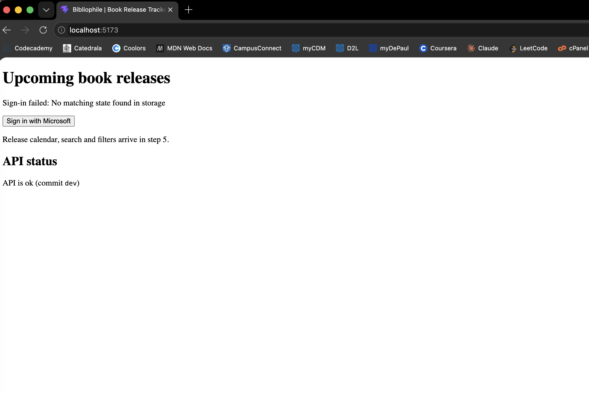

# F7 — OAuth 2.0 / OIDC login evidence (redacted HAR)

**Claim:** login uses Entra ID with the Authorization Code flow + PKCE, and
sends and checks `state` and `nonce`. There is no home-made password handling:
the password is typed into Microsoft's page, never into ours.

Code: `web/src/auth/userManager.ts`, `web/src/auth/AuthContext.tsx`.

## 1. Record the login (Chrome)

1. Start the app (`npm run dev:api`, `npm run dev:web`) and open
   `http://localhost:5173` in a **private window**, so no old session is reused.
2. Open DevTools → **Network**. Tick **Preserve log**.
3. Click **Sign in with Microsoft** and sign in as **Test Reader**.
4. When you're back on the app and it shows your name and roles, click the
   download arrow in the Network panel (**Export HAR**) → save as
   `login-raw.har` **outside the project folder** (e.g. Desktop).

The raw HAR contains the test user's password, the authorization code, tokens
and cookies. Never commit, upload or screenshot it.

## 2. Redact it

```bash
node scripts/redact-har.mjs ~/Desktop/login-raw.har docs/evidence/login-flow.redacted.har
rm ~/Desktop/login-raw.har
```

The script refuses to write anything if a token-shaped value survives.

## 3. What to point to in the redacted file

Search the file for these, and paste the lines below.

| Step | Request | What it proves |
| --- | --- | --- |
| 1 | `GET .../{tenant}/v2.0/.well-known/openid-configuration` | Real provider, discovered from Entra |
| 2 | `GET .../oauth2/v2.0/authorize?...` with `response_type=code`, `code_challenge=…`, `code_challenge_method=S256`, `state=…`, `nonce=…` | Authorization Code + PKCE, state and nonce **sent** |
| 3 | Microsoft login pages (`/login`, etc.) | The password goes to Microsoft (redacted), not to our app |
| 4 | `GET localhost:5173/auth/callback?code=[REDACTED]&state=…` | Same `state` value comes back as in step 2 |
| 5 | `POST .../oauth2/v2.0/token` with `grant_type=authorization_code`, `code_verifier=[REDACTED]` | PKCE verifier sent only to the token endpoint; no client secret |
| 6 | `GET localhost:5173/api/me` → 200, `Authorization: [REDACTED]` | API accepted the access token (F8) and reports the role (F9) |

`nonce` is **checked** by oidc-client-ts when the ID token arrives: it rejects
the login if the token's `nonce` claim differs from the one stored before the
redirect (`_validateIdTokenAttributes` in the library). The token itself is
redacted, so this half is shown by code reference, not by the HAR.

### Paste here (commit `562664a9ac62ca004a3e36b93a213cbcb792ddfe`, date ran script `11/06/2026`)

```
discovery:https://login.microsoftonline.com/1e3a78c9-1d2e-4f9d-bfa2-516560e44854/v2.0/.well-known/openid-configuration

authorize request URL: https://login.microsoftonline.com/1e3a78c9-1d2e-4f9d-bfa2-516560e44854/oauth2/v2.0/authorize?client_id=381a27b9-49b8-4b65-825a-d896f65690e2&redirect_uri=http%3A%2F%2Flocalhost%3A5173%2Fauth%2Fcallback&response_type=code&scope=openid+profile+offline_access+api%3A%2F%2Fc815aa80-06ef-4e34-90d6-8e721dad1bb3%2FReleases.Read+api%3A%2F%2Fc815aa80-06ef-4e34-90d6-8e721dad1bb3%2FReleases.Write+api%3A%2F%2Fc815aa80-06ef-4e34-90d6-8e721dad1bb3%2FWatchlist.ReadWrite&nonce=Sj81s2efSJ5Pb-gJTZxkSS8bP_bCbVUdWPjNN9a_IC0&state=93268fb9f27245c4a53f227fb99fcdfb&code_challenge=YlLEHOgZJQXgTG6bFeuS-QHAHI2bTk5QR-UQXN5J5f8&code_challenge_method=S256

Microsoft login page URL: https://login.microsoftonline.com/1e3a78c9-1d2e-4f9d-bfa2-516560e44854/login

callback URL: http://localhost:5173/auth/callback?code=%5BREDACTED%5D&state=93268fb9f27245c4a53f227fb99fcdfb&session_state=%5BREDACTED%5D 

token request body: "method": "POST",
          "url": "https://login.microsoftonline.com/1e3a78c9-1d2e-4f9d-bfa2-516560e44854/oauth2/v2.0/token",
          "httpVersion": "HTTP/1.1",
          URL: grant_type=authorization_code&redirect_uri=http%3A%2F%2Flocalhost%3A5173%2Fauth%2Fcallback&code=%5BREDACTED%5D&code_verifier=%5BREDACTED%5D&client_id=381a27b9-49b8-4b65-825a-d896f65690e2

/api/me response status and body: 
        "connection": "5173",
        "request": {
          "method": "GET",
          "url": "http://localhost:5173/api/me",
          "httpVersion": "HTTP/1.1",
           ...
          "response": {
          "status": 200,
          "statusText": "OK",
          "httpVersion": "HTTP/1.1",
          ...
          Reports role:
          "cookies": [],
          "content": {
            "size": 156,
            "mimeType": "application/json",
            "compression": 0,
            "text": "{\"subject\":\"62ed3f40-0f6e-40a9-822b-aa0fed1242ed\",\"name\":\"Test Reader\",\"roles\":[\"Reader\"],\"scopes\":[\"Releases.Read\",\"Releases.Write\",\"Watchlist.ReadWrite\"]}"
          },
```

## 4. A deliberate failure (Q3)

Show that state is enforced by sending back a login response the app never started:

In a private window, open the app and click Sign in with Microsoft.
On Microsoft's sign-in page, edit the state= value in the address bar (e.g. replace its first 4 characters with xxxx) and press Enter.
Sign in as Test Reader.
The app should show "Sign-in failed: No matching state found in storage" and stay signed out.

Screenshot the edited address bar and the error (nothing secret is on screen).

(Deleting the stored state in DevTools doesn't work as a test: while you're on Microsoft's page, DevTools only shows Microsoft's storage, and the app deletes the entry as soon as you're back.)

## 5. Interpretation
URL: https://login.microsoftonline.com/1e3a78c9-1d2e-4f9d-bfa2-516560e44854/oauth2/v2.0/authorize?client_id=381a27b9-49b8-4b65-825a-d896f65690e2&redirect_uri=http%3A%2F%2Flocalhost%3A5173%2Fauth%2Fcallback&response_type=code&scope=openid+profile+offline_access+api%3A%2F%2Fc815aa80-06ef-4e34-90d6-8e721dad1bb3%2FReleases.Read+api%3A%2F%2Fc815aa80-06ef-4e34-90d6-8e721dad1bb3%2FReleases.Write+api%3A%2F%2Fc815aa80-06ef-4e34-90d6-8e721dad1bb3%2FWatchlist.ReadWrite&nonce=xX_KtA8Gfkf0sc2UhFT2obITzz5XBtJb-tX5DyayaGQ&state=xxxxe1a7c6745af93f2dfe13e1dc1c4&code_challenge=xdLKkgUeu7JD1xwNGPlKLZP-2p-tcBnXjE_UKnZxmbQ&code_challenge_method=S256&sso_reload=true 
Screenshot:


I deliberately modified the state parameter in the URL to simulate a mismatch. I changed the first 4 letter in the state value to xxxx. By doing this, the app could not find a matching state in its storage. As a result, it displayed the error message "Sign-in failed: No matching state found in storage." This demonstrated that the app correctly checks the state parameter and does not accept a response with an unexpected state. This deliberate mismatch triggered the app's error handling, confirming that the state is enforced and prevents replay attacks.

## Challenged claim worth recording

oidc-client-ts does **not** send a `nonce` for the code flow unless one is
passed to `signinRedirect()`. Checked on 2026-11-04 by capturing the authorize
URL in a headless browser with and without `{ nonce: randomNonce() }`: without
it, there was no `nonce` parameter at all. Re-check this yourself (remove the
argument in `AuthContext.tsx`, sign in, look at the authorize URL in the
Network tab, put it back) before putting it in your AI use log.
